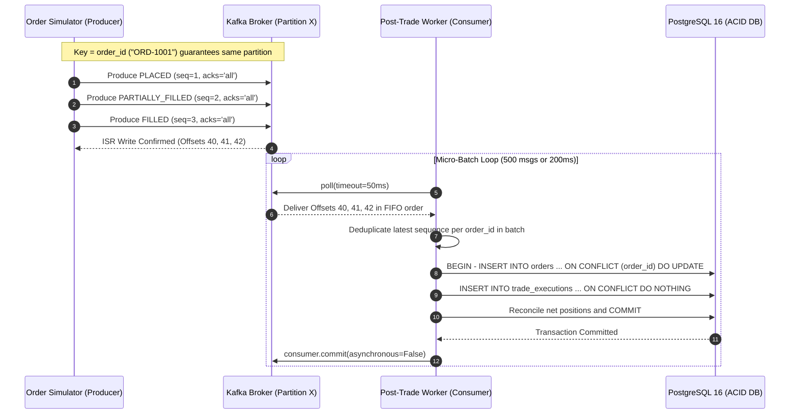

# PulseTrade SEFO — High-Frequency Post-Trade & Market Data Platform


## 1. Executive Overview & Alignment with PlusWealth SEFO Role

**PulseTrade SEFO** is a production-grade, 7.5/10 difficulty reference implementation engineered specifically for the **Software Developer (SEFO)** role at **PlusWealth Capital Management LLP**. It fulfills every core responsibility and technical qualification in the job description:

| JD Requirement | PulseTrade SEFO Implementation |
| :--- | :--- |
| **Post-Trade Platform Tools** | `src/consumers/post_trade_worker.py` — Micro-batch Kafka consumer (`enable.auto.commit=False`) performing atomic PostgreSQL upserts (`ON CONFLICT DO UPDATE`) and real-time net position reconciliation. |
| **Apache Kafka Event Streaming** | Dual-pipeline design: **`executed-trades`** (`acks='all'`, `enable.idempotence=True`, partitioned by `order_id`) and **`market-data-ticks`** (`acks=0` ultra-low-latency fire-and-forget stream). |
| **Trading Infrastructure Support & Diagnostics** | `src/consumers/tick_cache_worker.py` + `/api/v1/diagnostics/lag` — Tracks per-partition consumer offsets and worker heartbeats in Redis for live operational monitoring. |
| **Market Data Download Workflows** | `src/pipelines/eod_downloader.py` — Asynchronous (`asyncio` + `Semaphore`) concurrent OHLCV downloader with exponential backoff retries and idempotent SQL persistence. |
| **Relational & Non-Relational Databases** | **PostgreSQL 16** for ACID post-trade ledgers, composite B-Tree indexing, and EOD historical data; **Redis 7** for sub-millisecond L1 tick snapshots and health telemetry. |
| **Scalable RESTful APIs & Frontend Contracts** | `src/api/main.py` — Versioned `/api/v1` FastAPI backend with strict Pydantic v2 contracts, cursor/offset pagination, and live mark-to-market unrealized PnL enrichment. |
| **CI/CD Automation** | `.github/workflows/ci.yml` + `docker-compose.yml` — Automated linting (`ruff`) and unit/async testing (`pytest`) alongside single-command container orchestration. |

---

## 2. End-to-End Order Lifecycle & Idempotent Reconciliation Flow


### How Zero Data Loss & Strict Ordering Work Together



1. **Deterministic Partition Routing (`Key = order_id`):** Every state transition (`PLACED` $
ightarrow$ `PARTIALLY_FILLED` $
ightarrow$ `FILLED` / `CANCELLED`) hashes `order_id` to the exact same Kafka partition, preventing out-of-order race conditions across workers.
2. **Micro-Batching for High Throughput:** Instead of committing offsets per message (which causes 20,000 synchronous network round-trips/sec), `post_trade_worker.py` buffers up to **500 events or 200ms**, writes them in a single bulk SQL transaction via `psycopg2.extras.execute_values`, and commits the Kafka offset synchronously **once per batch**.
3. **Replay-Safe Idempotency (`sequence_num` Guard):** The SQL `ON CONFLICT (order_id) DO UPDATE ... WHERE EXCLUDED.sequence_num >= orders.sequence_num` clause guarantees that if a worker crashes before committing offsets and replays older events, stale states can never overwrite newer states.

---

## 3. Repository Structure

```text
pulsetrade-sefo/
├── docker-compose.yml               # Kafka (KRaft), PostgreSQL 16, Redis 7
├── requirements.txt                 # Pinned Python dependencies
├── .env.example                     # Environment configuration template
├── .github/workflows/ci.yml         # Automated Ruff + Pytest CI pipeline
├── docs/
│   ├── ARCHITECTURE_AND_FLOWS.md    # Deep-dive system design & interview guide
│   └── images/
│       ├── system_architecture.png  # High-res architecture diagram
│       └── order_lifecycle_flow.png # High-res order reconciliation flow
├── sql/
│   └── init_schema.sql              # DDL for orders, executions, positions, eod_market_data
├── src/
│   ├── config/settings.py           # Pydantic BaseSettings configuration
│   ├── producers/
│   │   ├── order_simulator.py       # acks='all', idempotent order lifecycle stream
│   │   └── tick_simulator.py        # acks=0 high-frequency L1 tick stream
│   ├── consumers/
│   │   ├── post_trade_worker.py     # Manual commit micro-batch SQL reconciler
│   │   └── tick_cache_worker.py     # Redis pipeline writer & heartbeat emitter
│   ├── pipelines/
│   │   └── eod_downloader.py        # Asyncio concurrent EOD market data ingestion
│   └── api/
│       ├── main.py                  # FastAPI application (/api/v1)
│       └── v1/schemas.py            # Clean Pydantic v2 request/response contracts
└── tests/
    └── test_suite.py                # Unit & async tests for API, producers & EOD pipeline
```

---

## 4. Quickstart Instructions

### Step 1: Start Infrastructure Containers
```bash
docker compose up -d
```

### Step 2: Install Python Dependencies
```bash
python -m venv .venv
source .venv/bin/activate
pip install -r requirements.txt
```

### Step 3: Run the Consumers & Producers
Open separate terminals to observe the real-time pipeline in action:
```bash
# Terminal 1: Start Post-Trade SQL Reconciler Worker
python -m src.consumers.post_trade_worker

# Terminal 2: Start Live Tick Redis Cache Worker
python -m src.consumers.tick_cache_worker

# Terminal 3: Simulate Order Lifecycles & Market Ticks
python -m src.producers.order_simulator
python -m src.producers.tick_simulator

# Terminal 4: Launch FastAPI Control Plane
uvicorn src.api.main:app --reload --port 8000
```

### Step 4: Run Automated Test Suite
```bash
pytest -v tests/
```

---

## 5. RESTful API Reference (`/api/v1`)

| Method | Endpoint | Description | Storage Engine |
| :--- | :--- | :--- | :--- |
| `GET` | `/api/v1/health` | Service liveness & API version check | In-Memory |
| `GET` | `/api/v1/orders` | Paginated post-trade order ledger (`?symbol=NIFTY&status=FILLED&limit=50&offset=0`) | PostgreSQL |
| `GET` | `/api/v1/positions` | Net positions enriched with live Redis L1 prices & unrealized PnL | PostgreSQL + Redis |
| `GET` | `/api/v1/market-data/{symbol}/quote` | Sub-millisecond L1 bid/ask/LTP snapshot for frontend dashboards | Redis |
| `GET` | `/api/v1/diagnostics/lag` | Worker heartbeat status and latest processed offsets per partition | Redis |
| `POST` | `/api/v1/pipelines/eod-trigger` | Triggers concurrent `asyncio` EOD market data download & SQL upsert | Async HTTP + PostgreSQL |
