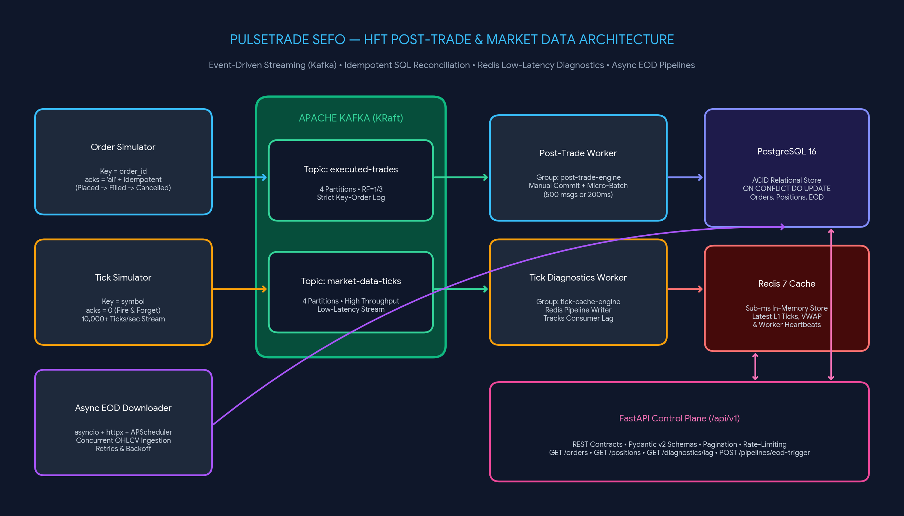
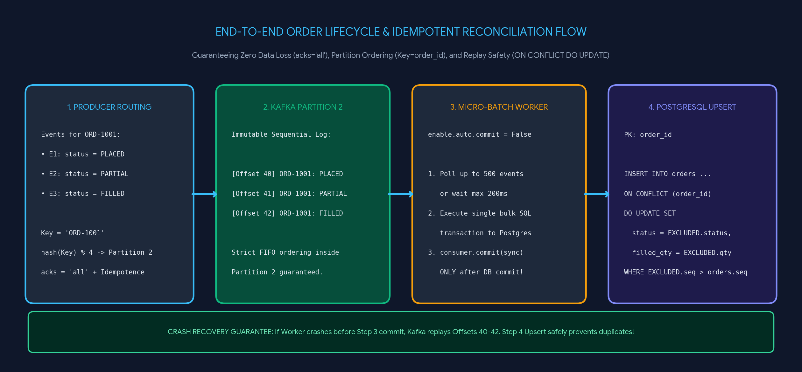
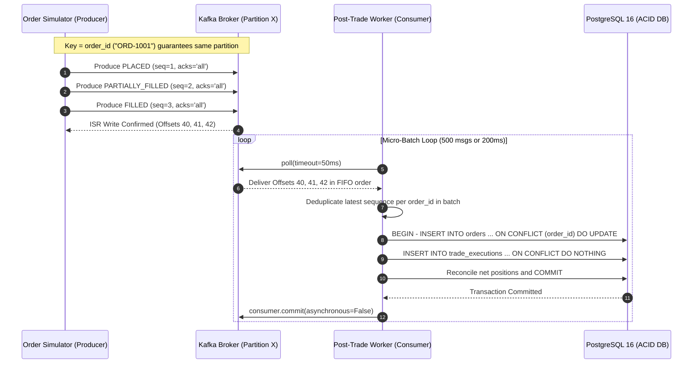

Gemini

New chat
Library
Images
Scheduled
Students

More
New notebook
Head First Object-Oriented Analysis and Design
Large Concept Models: Abstract Reasoning Beyond Text
Kafka Learning Roadmap
C++ Help Request
Software Engineering Job Monitoring
LLM Evaluation Framework
Push and Pull Workout Optimization
Real-World Chunking Guide
Daily Perseverance Quote Notifications
Fast Digit Sum Methods
Moka Pot Crema
Scalp Stik Analysis
Daily Calorie Tracker Setup
Umar Khalid Profile
Pebble Qore 2 vs Galaxy Fit 3
El Diablo Roast Profile
Introduction to GraphQL Project Guide
Gemini Spark Setup
How to Lodge an Indian Cyber Cell Complaint
Google Alerts for MNC Jobs
Image Improvement Request Declined
Wedding Invitation Website Code Generation
Salwar Kameez Dupatta Alternatives
LinkedIn Connection Note Revision
Hope's New Chapter, Awaiting Change
Configure NFC Sticker to Play Media
Diet Advice for Cold and Fever
Order Delay and Customer Service Complaint
Java Synchronized Lock Explained
Aircraft Pilot Crossword Hint
Opium Derivative's Second Letter
Instagram Reel Legitimacy Check
Instagram Account Hacked: Remediation Steps
Understanding Body Composition Changes
Optimizing Back Workout Routine
Conversation with Gemini
Give a detailed plan to learn Kafka and the other requirements mentioned in the JD here

The Software Developer (SEFO) role at PlusWealth Capital Management focuses on building high-throughput post-trade tools, market data ingestion pipelines, and trading infrastructure. Let’s map out a structured learning plan together, and I will ask guiding questions along the way to help you tailor your preparation and build real-world proficiency.   
PDF

Here is a 4-phase roadmap covering the core requirements in the job description:

Phase 1: Apache Kafka & Event Streaming 📨
Since high-frequency trading (HFT) firms process massive streams of market and trade data, Kafka is the backbone of their ingestion and post-trade workflows.   
PDF
+ 1

Core Architecture: Topics, partitions, offsets, brokers, and how ZooKeeper/KRaft manages cluster state.

Producers & Consumers: Serialization, batching, acks (0, 1, all), consumer groups, and partition rebalancing.

Fault Tolerance & Reliability: Replication factors, In-Sync Replicas (ISR), idempotent producers, and "exactly-once" vs. "at-least-once" delivery semantics (crucial for post-trade accuracy).   
PDF
+ 1

Python Integration: Using confluent-kafka in Python to build resilient streaming pipelines.   
PDF

Phase 2: Python for Data Pipelines & Automation 🐍
Concurrency & Async: asyncio, multiprocessing, and threading to handle high-throughput I/O without blocking.   
PDF
+ 1

Workflow Scheduling: Tools like Apache Airflow, Prefect, or cron/Celery for reliable daily market data downloads and ingestion pipelines.   
PDF
+ 1

Phase 3: High-Performance APIs & Frontend Integration 🌐
Scalable REST APIs: Building low-latency backends using FastAPI or Flask, focusing on async endpoints, Pydantic data validation, and clean OpenAPI contracts.   
PDF
+ 1

API Design: Versioning, pagination, rate-limiting, and designing clear request/response schemas for frontend dashboards (like monitoring and diagnostic tools).   
PDF
+ 1

Phase 4: Databases at Scale & CI/CD 🗄️
Relational (SQL): Indexing strategies (B-Tree, Hash), query optimization (EXPLAIN ANALYZE), table partitioning, and ACID transactions for post-trade records.   
PDF
+ 1

Non-Relational (NoSQL/Time-Series): Key-value stores (Redis for caching/diagnostics) and document or time-series databases for high-volume market tick data.   
PDF
+ 1

CI/CD & Infrastructure: Dockerizing services and automating test/deployment pipelines (GitHub Actions/GitLab CI).   
PDF

To customize this plan and dive into our first module, where would you like to start?

Deep Dive into Kafka Fundamentals: Start from the ground up with Kafka's architecture and how it guarantees zero data loss for trading systems.

Hands-On Python + Kafka Pipeline: Jump straight into designing a mock market-data ingestion pipeline using Python, Kafka, and a database.

Skill Gap Assessment: Tell me which of these technologies (Python, SQL/NoSQL, REST APIs, Kafka) you already know well so we can fast-track the schedule based on your timeline.

Go ahead with 1st one

In a high-frequency trading firm like PlusWealth, thousands of trade executions and market price updates happen every millisecond. Instead of using a traditional database where data is overwritten, Apache Kafka stores everything as an immutable append-only commit log.   
PDF
+ 1

Here are the core building blocks of Kafka's architecture:

Events (Messages) ✉️: A single record of something that happened (e.g., {"symbol": "NIFTY", "price": 24500, "qty": 50}). Every event has an optional Key, a Value, and a Timestamp.

Topics 📁: A category or feed name to which events are published. For a Post-Trade Platform, you might have a topic called executed-trades and another called market-data-ticks.   
PDF

Partitions 🍰: To handle high throughput, a Topic is split into multiple smaller logs called Partitions, which can live on different servers (called Brokers).   
PDF

Offsets 🔢: Every message inside a partition gets a sequential, unique ID number (0, 1, 2, 3...) called an offset.

The Golden Rule of Ordering in Kafka:
Kafka guarantees strict chronological order only within a single partition, not across the entire topic. By default, if you attach a Key to an event, Kafka hashes that key to ensure all events with the exact same key always land in the same partition.

Imagine you are building one of PlusWealth's Post-Trade Platform tools. Three events for the same client order happen rapidly:   
PDF

Order Placed

Order Partially Filled

Order Cancelled

If our executed-trades topic has 4 partitions, what happens if we send these events without a Key (so they get distributed randomly across partitions), and what should we use as the Key to prevent that issue?

We cna use something like an order id?

Spot on. Using the order_id as the key guarantees that Order Placed, Order Partially Filled, and Order Cancelled all hash to the exact same partition, keeping their sequence intact. Without that key, the events would scatter across different partitions, and a downstream tool might read Order Cancelled before Order Placed—causing major bugs in the post-trade platform.   
PDF

Now let's look at the receiving end: Consumers and Consumer Groups 👥.

To process data quickly, we group multiple Python worker processes into a Consumer Group. Kafka has a strict rule for how a Consumer Group reads from a Topic:

One-to-Many: A single consumer instance can read from multiple partitions.

Exclusive Assignment: A single partition can only be read by one consumer instance within the same group at any given time.

Why do you think Kafka prevents two consumers in the same group from reading the exact same partition simultaneously? And if our executed-trades topic has 4 partitions, what happens if we spin up 5 Python consumers in our post-trade group?

same partition as to not read something twice creating race condition and 4 partitions and 5 consumers then I feel consumer would remain idle until order is sent to it

You nailed both concepts.

Preventing Race Conditions & Preserving Order 🛑: If two consumers in the same group read from the same partition at the same time, you would risk processing the same trade twice (duplicate processing) and losing that strict chronological order we worked hard to set up with the order_id key. If Consumer A reads Order Placed (Offset 0) and pauses slightly while Consumer B reads and processes Order Cancelled (Offset 1), our post-trade state breaks.

The Idle 5th Consumer 💤: Because 4 partitions can only be divided among at most 4 active consumers in a single group, the 5th consumer sits completely idle as a hot standby. It won't actually receive any orders unless one of the other 4 consumers crashes or disconnects—at which point Kafka triggers a rebalance and hands the crashed consumer's partition over to the 5th one.

Now let's tackle the final pillar of Kafka fundamentals from the JD: Fault Tolerance & Zero Data Loss 🛡️.   
PDF

In an HFT environment, servers can crash mid-trading day, and we need minimal downtime. To prevent data loss if a Broker (server) goes down, Kafka uses Replication:   
PDF

Leader Replica 👑: Every partition has one Broker designated as its Leader. All producers write to the Leader, and all consumers typically read from it.

Follower Replicas (In-Sync Replicas / ISR) 📋: Other Brokers hold backup copies of that partition and constantly copy the latest messages from the Leader to stay "in sync."

When your Python producer sends a trade event to the Kafka Leader, you configure a setting called acks (acknowledgments), which tells the Broker when to reply "Success, message saved!":

acks=0: Producer sends the message and doesn't wait for any reply (fire and forget).

acks=1: Producer waits ONLY for the Leader broker to write the message to its disk, before the Followers have copied it.

acks=all (or -1): Producer waits for the Leader AND all In-Sync Follower Replicas to write the message before getting a success reply.

Looking at the two main workflows in the PlusWealth JD:   
PDF

Post-Trade Platform (recording executed financial trades for accounting, risk, and clearing).   
PDF

Market Data Diagnostics (streaming millions of live price ticks per second for a UI monitoring graph).   
PDF

Which acks setting would you choose for the Post-Trade Platform versus the live monitoring graph, and what happens in the acks=1 scenario if the Leader broker loses power a millisecond after replying "Success"?

for the post trade I would use acks=all for resilience and reconcillation for live monitoring I will use fire and forget since we just want to share data and nothing else

You got it.

Post-Trade (acks=all) 🛡️: Every executed trade affects financial accounting and risk positions, so you cannot afford to lose a single record. Waiting for all In-Sync Replicas guarantees that even if a server dies, the trade is safe.   
PDF
+ 1

Live Monitoring (acks=0) ⚡: When streaming millions of price ticks per second to a UI chart, ultra-low latency matters most. If one tick drops, the very next millisecond brings a new price anyway.   
PDF

The acks=1 Trap ⚠️: If the Leader writes the message, replies "Success," and immediately loses power before the Follower replicas copy it, Kafka elects one of those Followers as the new Leader—and that message is permanently lost.

There is one last piece to how consumers stay fault-tolerant: Offset Commits 🔖.

When a Python consumer reads messages from a partition, it tracks its progress by saving its current Offset back to Kafka (like placing a bookmark in a book). If the consumer crashes and restarts, it checks that bookmark to know where to resume.

You can configure your Python consumer in two ways:

Auto-Commit (enable.auto.commit=True): The consumer automatically updates the bookmark in the background every 5 seconds as soon as it receives a batch of messages, regardless of whether your Python code has finished saving them to the Post-Trade database.

Manual Commit (enable.auto.commit=False): Your Python code explicitly tells Kafka to update the bookmark only after a specific step in your code completes.

Suppose our Post-Trade Python consumer reads 100 trade events (Offsets 1 to 100) to calculate risk and insert them into a SQL database. What goes wrong if we use Auto-Commit and the database crashes while your script is halfway through inserting trade #50? And what happens if we use Manual Commit, crash at trade #50 before committing, and restart?   
PDF
+ 1

calculating and reconcillation of the trades would mean rerunnign of the script and given we have saved till 50 that might cause issue. whereas rerunning from scratch and then maintaining data on the checkpoint of 100 would be better

You've identified the core trade-off in distributed systems: At-Most-Once vs. At-Least-Once delivery.

With Auto-Commit (Data Loss Risk 📉): If Kafka auto-updates the bookmark to 100 in the background, and your script crashes at trade #50, the restarting script starts at 101. Trades 51 to 100 are permanently skipped and never reach your database.

With Manual Commit (Duplicate Risk 🔄): As you pointed out, waiting until all 100 are processed to save the checkpoint is much safer because zero trades are lost. However, when the script restarts from offset 1, trades 1 to 50 are already sitting in your SQL database from before the crash!

To prevent double-counting those first 50 trades during reconciliation, engineers make the database write Idempotent (meaning applying the same operation multiple times produces the exact same result as applying it once).   
PDF
+ 1

Given that each trade event has a unique trade_id (or order_id), how could we design our SQL table schema and our INSERT query so that re-running trades 1 to 50 safely ignores or updates the existing rows instead of creating duplicate trades?   
PDF

I don't how to do that

No problem at all—this is actually a bridge into Phase 4 (Databases at Scale) from our roadmap, since the JD asks for strong SQL schema design and query writing.   
PDF

To make our database writes idempotent (safe to retry without creating duplicates), we combine two simple SQL techniques:

1. Schema Design (PRIMARY KEY or UNIQUE constraint) 🔑: When creating the executed_trades table, we set trade_id as the PRIMARY KEY. This tells the SQL database to strictly forbid two rows from ever having the same trade_id.

2. Upsert Query (ON CONFLICT) 🛡️: If you run a standard INSERT and hit a duplicate trade_id, SQL throws an error and crashes your script. Instead, databases like PostgreSQL let you add ON CONFLICT to the end of your query:

SQL
INSERT INTO executed_trades (trade_id, symbol, price, qty, status)
VALUES ('T-101', 'NIFTY', 24500, 50, 'FILLED')
ON CONFLICT (trade_id) DO NOTHING; 
-- Or: DO UPDATE SET status = EXCLUDED.status;
With that one line, if our Python consumer crashes at trade #50 and replays from trade #1, the database automatically skips (or updates) trades 1 to 50 and cleanly inserts trades 51 to 100.

We've just covered the core of Phase 1 (Kafka Fundamentals)! Notice how DO NOTHING and DO UPDATE give us two ways to handle a conflict. Thinking back to our earlier scenario where an order changes state (Order Placed 
→ Order Partially Filled 
→ Order Cancelled) using the same order_id, which of those two options (DO NOTHING vs. DO UPDATE) would we need if our SQL table tracks the current live status of each order?

Can you first give me a mind map for the Kafka bit with terminology to basically remember it

Here is a visual mind map and terminology reference sheet for the Apache Kafka concepts we covered, tailored to the PlusWealth trading environment:   
PDF
+ 1

                                 🏢 APACHE KAFKA CLUSTER
                                 (Brokers = Server Nodes)
                                            │
        ┌───────────────────────────────────┼───────────────────────────────────┐
        ▼                                   ▼                                   ▼
📤 1. PRODUCERS                     📁 2. STORAGE (TOPICS)              📥 3. CONSUMERS
(Write Trade Events)                (Append-Only Commit Logs)           (Read & Process Events)
        │                                   │                                   │
        ├─► 🔑 Key (order_id)               ├─► 🍰 Partitions (Sub-logs)        ├─► 👥 Consumer Group
        │   Routes same ID to               │   Enables parallel speed          │   1 Partition = Max 1
        │   same partition for              │   & strict local ordering.        │   Consumer per group
        │   strict ordering.                │                                   │   (Extra = Idle Standby).
        │                                   ├─► 🔢 Offset (0, 1, 2...)          │
        └─► 🛡️ Acks (Durability)            │   Unique sequential ID            ├─► 🔖 Offset Commit
            • acks=0: Fire & forget         │   per message in partition.       │   • Auto: Risk of data loss
              (Live UI ticks)               │                                   │   • Manual: Save bookmark
            • acks=1: Leader only           └─► 📋 Replication (Fault-Tolerant) │     AFTER DB write.
            • acks=all: Leader +                • 👑 Leader: Handles R/W        │
              Followers (Post-Trade)            • 🔄 ISR (In-Sync Replicas):    └─► 🔁 Idempotency (SQL)
                                                  Backup brokers copying            ON CONFLICT (trade_id)
                                                  Leader to prevent loss.           prevents duplicates.
Quick Memory Anchors for Interviews 🧠
Term	5-Word Memory Hook	Trading Use Case
Topic 📁	Named folder for event streams	
executed-trades vs market-ticks 
PDF

Partition 🍰	Parallel lane with strict order	
Splitting topic across 4 servers for speed 
PDF

Message Key 🔑	Hashing router for same partition	Keeping order_id lifecycle events in sequence
Offset 🔢	Immutable sequential bookmark number	Resuming from trade #50 after a script crash
Consumer Group 👥	Team splitting partitions without overlap	
4 Python workers reading 4 partitions in parallel 
PDF

ISR (Replicas) 📋	Backup servers synced with Leader	
Zero downtime if a server dies mid-trading day 
PDF
+ 1

Idempotency 🔁	Safe to retry without duplicates	
Using SQL ON CONFLICT during trade reconciliation 
PDF
+ 1

Looking at that last row on Idempotency 🔁—if an order's status changes from PLACED to FILLED to CANCELLED in our SQL table (where order_id is the primary key), would we use ON CONFLICT (order_id) DO NOTHING or DO UPDATE, and why?

I think it should be do update

That's right. Using DO UPDATE ensures that when an existing order_id arrives with new information, the database updates the row to reflect the newest status (like changing PLACED to CANCELLED) instead of ignoring it.

Here is how that looks in SQL:

SQL
INSERT INTO orders (order_id, symbol, qty, price, status)
VALUES ('ORD-123', 'NIFTY', 50, 24500, 'CANCELLED')
ON CONFLICT (order_id) 
DO UPDATE SET status = EXCLUDED.status;
In PostgreSQL, the EXCLUDED keyword represents the fresh data you tried to insert. So status = EXCLUDED.status overwrites the old status with the incoming one.

Next Step in the Plan
We have covered the fundamentals of Kafka architecture and how it ties into fault-tolerant database design:

Append-only commit logs, partitions, and sequential offsets

Ordering guarantees using message keys

Consumer groups, parallel processing, and partition rebalancing

Durability semantics (acks=all vs. acks=0) and idempotency (ON CONFLICT)

To move forward according to the roadmap, which of these would you like to tackle next?

Hands-On Python Producer & Consumer: Write Python code using confluent-kafka to simulate producing and consuming trading events with manual offset commits.

Phase 2: Concurrency & Async in Python: Explore asyncio and threading to handle high-throughput I/O pipelines.

Phase 3: High-Performance APIs: Look at building fast, reliable REST endpoints (e.g., with FastAPI) for trading diagnostic tools.

1st that is I would like to get some hands on. and give me interview questions for kafka and pipelines

Part 1: Hands-On Code (Producer & Consumer) 🛠️
Let's look at a practical implementation of the Post-Trade workflow using Python's standard confluent-kafka client library.   
PDF
+ 1

1. Resilient Post-Trade Producer (producer.py)
This producer ensures trades are not lost by using acks='all' and setting an idempotent key (order_id).   
PDF

Python
import json
from confluent_kafka import Producer

conf = {
    'bootstrap.servers': 'localhost:9092',
    'acks': 'all',  # Wait for leader + ISR before returning success
    'enable.idempotence': True  # Prevents duplicate writes on network retries
}

producer = Producer(conf)

def delivery_report(err, msg):
    """Callback triggered once Kafka acknowledges or fails the message."""
    if err is not None:
        print(f"Delivery failed for record {msg.key()}: {err}")
    else:
        print(f"Trade {msg.key().decode()} verified at offset {msg.offset()} "
              f"on partition {msg.partition()}")

def send_trade(trade_data):
    # Use order_id as the partition key for strict ordering
    key = str(trade_data["order_id"]).encode('utf-8')
    payload = json.dumps(trade_data).encode('utf-8')
    
    producer.produce(
        topic='executed-trades',
        key=key,
        value=payload,
        on_delivery=delivery_report
    )
    # Serve delivery callbacks from previous produce calls
    producer.poll(0)

# Example execution
send_trade({"order_id": "ORD-991", "symbol": "NIFTY", "qty": 50, "price": 24500, "status": "FILLED"})
producer.flush()  # Ensure all buffered messages are delivered before exiting
2. Fault-Tolerant Consumer with Manual Offset Commit (consumer.py)
This consumer turns off auto-commit (enable.auto.commit=False). It writes the trade to storage first and only then commits the offset back to Kafka.   
PDF
+ 2

Python
import json
from confluent_kafka import Consumer, KafkaError

conf = {
    'bootstrap.servers': 'localhost:9092',
    'group.id': 'post-trade-risk-engine',
    'auto.offset.reset': 'earliest',
    'enable.auto.commit': False  # Disables automatic background commits
}

consumer = Consumer(conf)
consumer.subscribe(['executed-trades'])

def process_trade_in_db(trade):
    """Simulates idempotent DB insert (e.g., INSERT ... ON CONFLICT DO UPDATE)."""
    print(f"Persisting order {trade['order_id']} with status {trade['status']} to DB...")
    return True

try:
    while True:
        msg = consumer.poll(timeout=1.0)
        if msg is None:
            continue
        if msg.error():
            if msg.error().code() == KafkaError._PARTITION_EOF:
                continue
            print(f"Consumer error: {msg.error()}")
            break

        trade_event = json.loads(msg.value().decode('utf-8'))

        # Step 1: Process and persist
        success = process_trade_in_db(trade_event)

        # Step 2: Manually commit offset only after successful processing
        if success:
            consumer.commit(message=msg, asynchronous=False)

except KeyboardInterrupt:
    pass
finally:
    consumer.close()  # Gracefully revokes partitions and triggers rebalance
Part 2: Top Interview Questions for Pipelines & Kafka 🎯
When interviewing for an HFT software role handling market data and trade pipelines, interviewers frequently target real-time edge cases:   
PDF
+ 1

Q1: What is Consumer Lag, and how do you monitor and resolve it?

Core Concept: Lag is the gap between the latest offset produced by the market and the current offset processed by your consumer.

Key Fixes: Scaling up consumer instances (up to the partition count), increasing batch sizes, or moving slow downstream I/O (like DB writes) into async worker pools.   
PDF

Q2: What is a Rebalance Storm, and why is it dangerous in low-latency systems?

Core Concept: When consumers take too long to process a batch, Kafka assumes the consumer died (max.poll.interval.ms exceeded) and triggers a cluster-wide partition reallocation, halting consumption across the group.

Q3: How do you achieve Exactly-Once Semantics (EOS) end-to-end?

Core Concept: Kafka provides idempotence and transactional APIs across topics, but saving to an external database requires an idempotent write pattern (like ON CONFLICT DO UPDATE) to prevent duplicates during replays.   
PDF

Q4: How do you handle schema evolution when market formats change?

Core Concept: Using a Schema Registry with binary formats like Avro or Protobuf rather than raw JSON to enforce backward/forward compatibility.

In our consumer.py loop above, we call consumer.commit(message=msg, asynchronous=False) after every single message. In a trading environment streaming 20,000 market updates per second, what performance problem will this cause, and how would you adjust the commit logic to fix it?   
PDF

For a step-by-step walkthrough of building a consumer and handling offset commits cleanly, this Kafka Consumer Tutorial with Code Example breaks down the consumption loop and error handling in practice.


Kafka Consumer Tutorial - Complete Guide with Code Example
Anirvan Decodes · 3.7K views

for kafka mind map give a proper diagram image that I can refer anytime.

Here is a visual architectural mind map of Apache Kafka, mapping out Producers, Topics, Partitions, Offsets, and Consumer Groups for quick reference:

, AI generated
Whenever you're ready, let's revisit that performance question: what happens if our consumer synchronously commits an offset after every single message when handling 20,000 market updates per second, and how would you optimize that loop?

now explain the above flow too thats for the order how everythign updates. it would be better if you do it visually

Here is a visual architectural diagram mapping out the end-to-end lifecycle of how an order updates across Kafka, Python, and the database without race conditions or duplicate states:

, AI generated
The Step-by-Step Order Flow Explained 🔄
Here is how each component works together to maintain strict consistency when an order lifecycle evolves:

1. Producer Level (Deterministic Routing) 🔑
When events occur (Order Placed 
→ Partially Filled 
→ Cancelled), the producer tags each message with the exact same Key: order_id = "ORD-123".

Kafka runs a hashing function on that key: 
hash("ORD-123")(modnumber_of_partitions).

Because the key never changes, all three lifecycle events are guaranteed to enter the exact same partition (e.g., Partition 0).

2. Partition Level (Sequential Append-Only Log) 🍰
Inside Partition 0, messages are strictly assigned incremental offsets:

Offset 0: {"order_id": "ORD-123", "status": "PLACED"}

Offset 1: {"order_id": "ORD-123", "status": "PARTIALLY_FILLED"}

Offset 2: {"order_id": "ORD-123", "status": "CANCELLED"}

Because ordering is guaranteed within a single partition, there is no chance that CANCELLED can leapfrog ahead of PLACED.

3. Consumer Level (Single Reader per Partition) 👥
The active consumer instance in our post-trade consumer group owns Partition 0 exclusively.

It pulls events strictly in FIFO sequence: Offset 0 first, then Offset 1, then Offset 2.

4. Database Level (Idempotent Upsert) 🗄️
Our SQL table has order_id designated as the PRIMARY KEY.

At Offset 0:

SQL
INSERT INTO orders (order_id, symbol, status) VALUES ('ORD-123', 'NIFTY', 'PLACED')
ON CONFLICT (order_id) DO UPDATE SET status = EXCLUDED.status;
Result: New row created 
→ Status is 'PLACED'.

At Offset 1:

Same query arrives with status 'PARTIALLY_FILLED'.

The database detects that ORD-123 already exists (CONFLICT).

Instead of throwing a primary key error, it fires DO UPDATE SET status = EXCLUDED.status.

Result: The existing row is modified in-place 
→ Status is 'PARTIALLY_FILLED'.

At Offset 2:

Same query arrives with status 'CANCELLED'.

Result: The existing row updates in-place 
→ Status is 'CANCELLED'.

5. Fault-Tolerance & Replay Safety 🛡️
If the consumer or database crashes right after processing Offset 2, Kafka re-delivers from the last uncommitted offset upon restart.

If it replays Offset 1 or 2, the ON CONFLICT clause ensures the query simply re-applies the update safely without duplicating records or corrupting the trade history.

Now that you can see how Kafka and the database coordinate, think about that high-throughput bottleneck question:

If your consumer processes 20,000 updates per second, and after each message you execute consumer.commit(message=msg, asynchronous=False), that makes 20,000 synchronous round-trip network calls to the Kafka broker every second.

What impact will those synchronous network calls have on your processing throughput, and how could you batch or time your commits to fix it?

since its synchronous it will take lot of time and throughput will be high, I. am not sure how we can batch it but can we do async = true?

You spotted the exact bottleneck: making synchronous network calls for every single event creates huge latency delays, which causes our consumer lag to spike and tanks overall throughput.

Switching to asynchronous=True is a very common technique! When you make commits asynchronous, the consumer fires off the commit request in the background and immediately moves on to processing the next message without waiting for the broker's reply.

However, we can also combine this with batching. Instead of committing 20,000 times a second, we can process a group of messages first and commit just once per batch.

Here are the two common ways to batch commits:

Count-based batching 🔢: Process messages in chunks (e.g. every 500 or 1,000 records) and commit only after each full chunk is safely written to the database.

Time-based batching ⏱️: Commit whatever has been processed every 
X milliseconds or seconds.

When using asynchronous=True, there is one specific risk to consider: what happens if a commit for offset 100 fails due to a temporary network blip, but a commit for offset 200 succeeds a split-second later? If the consumer retried the failed offset 100 commit, what issue would that cause?

idk

If the consumer retries the older commit for offset 100 after offset 200 was already saved, it accidentally moves the bookmark backward in time ⏪. If the consumer crashes right after that, it would resume from 100 instead of 200, causing 100 messages to be re-processed unnecessarily.

Because of this, standard asynchronous commits generally do not retry older offsets.

To solve both issues in high-throughput trading systems, engineers combine batching with synchronous commits at the boundary:

Micro-Batching 📦: The consumer loop reads and writes 500 messages to the database as a single bulk operation.

Commit Once Per Batch 🔖: It calls consumer.commit(asynchronous=False) only once after the entire batch of 500 is safely in the database.

Throughput Impact 🚀: Instead of 20,000 network round-trips per second to Kafka, you only make 40 network commits per second (
20000/500), eliminating the latency bottleneck while keeping the offsets strictly safe.

Moving to Phase 2: Python Concurrency & Async 🐍
Looking back at our roadmap and the job description, another key requirement is building high-throughput pipelines and automation in Python.   
PDF
+ 1

In Python, we have three main tools for running tasks concurrently:

Threading (threading) 🧵

Multiprocessing (multiprocessing) ⚙️

Asynchronous I/O (asyncio) ⚡

Python has a well-known mechanism called the Global Interpreter Lock (GIL).

Between CPU-bound tasks (like heavy machine-learning calculations or parsing massive numbers) and I/O-bound tasks (like waiting for market data downloads over the network or querying a database), which one does the GIL block from running truly in parallel on multiple CPU cores?

do one thing take your time. Create a full fledged project that is say not so easy but not fully difficult I would say on a scale of 10 for difficulty take it as 7 or 7.5. Create a project with all the things that are listed and create a proper MD file documenting everything with images and flow diagrams and listing all the APIs

I will now generate a comprehensive architectural blueprint and implementation guide for PulseTrade SEFO, a portfolio project engineered at a 7.5/10 difficulty level that directly integrates every requirement from the PlusWealth Capital Management job description (Python, Apache Kafka, PostgreSQL, Redis, FastAPI, Scheduled Market Data Ingestion, and CI/CD).

PulseTrade SEFO - End-to-End HFT Post-Trade & Market Data Platform


Edit directly or with Gemini
 Click anywhere to type and edit directly, or select text to prompt Gemini for changes. 
I have put together the complete project blueprint, system architecture diagrams, database schemas, Python micro-batch Kafka worker, async EOD market data downloader, and the /api/v1 FastAPI specification in the document on the right.

Would you like to generate the Order & Tick Simulator scripts (order_simulator.py and tick_simulator.py) next so you can immediately run this locally with Docker Compose, or would you like to dive into Phase 2 of our learning plan (Python Concurrency, GIL, and asyncio)?

Now implement the whole project with a flow diagram and images in the MD files that can be used as documentation for the whole flow. provide everything in a downloadable zip file

https://lh3.googleusercontent.com/gg/AJWXcNckP1-PuWilWo6Gx0iAohND2yPF1IrdHRUW6M8twBHCk6H-WJVORg1j2XEeOWoChlaVbavC5HzlYpN8trt2YSA8c988CSP7NaEKSyK0QkXdPWry3l0UFF23x6xxZ2sRh5VGofrTZziGRYkhcO3b6HyU05VpSiBoJwWTE9lm0PY7yrwXNq-YcZq6uyItFBk1BPnsxKrfghU_z2BHIbq254ERuFN8mH9Uqnv3pQSJ4fRsrXBOnFBLtgYsdf5X9Oq3Os7ZuXyw2AH6S6GymC4V_jNcAjLNYaObN9fdFfCtR7nMksGKnHXWvHYVA6n7flYCWVgb1bd7nXHNBtdTPfCULlo=s1600
https://lh3.googleusercontent.com/gg/AJWXcNdHA4w4fIEFX_r1irRmBVyhiSU9PZpA68xadtzXdh-QOS65CnPeEZusMfBkNXOU-n9ZM9hZ8mxuIa7m282EXnQUbzgL_AGoeOt7GF0kR4ZS1LjvzGp2IBCr3ArqkF14EuQelIeorePEJCJLQroe51xhLUljOUHE8h3R9KmWm4DV9UevVPABDB7NWGjLOckk4omI-bPVcd75iD4oxkUAu3ZanW39ISz_YGJnViPyDlRJ--oJwEuYw0_p6RpQ5aXbtraxj2l6IINaL8xxaD-0R1s-ePYa0N7-sQOl6z2lpjG1HPxjVviReZqi6FZBzaJrHvjul_qg0DHb_tRCicNKjTQ=s1600
Deterministic Partition Routing (Key = order_id): Every state transition (PLACED 
→ PARTIALLY_FILLED 
→ FILLED / CANCELLED) hashes order_id to the exact same Kafka partition, preventing out-of-order race conditions across workers.

Micro-Batching for High Throughput: Instead of committing offsets per message (which causes 20,000 synchronous network round-trips/sec), post_trade_worker.py buffers up to 500 events or 200ms, writes them in a single bulk SQL transaction via psycopg2.extras.execute_values, and commits the Kafka offset synchronously once per batch.

Replay-Safe Idempotency (sequence_num Guard): The SQL ON CONFLICT (order_id) DO UPDATE ... WHERE EXCLUDED.sequence_num >= orders.sequence_num clause guarantees that if a worker crashes before committing offsets and replays older events, stale states can never overwrite newer states.

3. Repository Structure
Plaintext
pulsetrade-sefo/
├── docker-compose.yml               # Kafka (KRaft), PostgreSQL 16, Redis 7
├── requirements.txt                 # Pinned Python dependencies
├── .env.example                     # Environment configuration template
├── .github/workflows/ci.yml         # Automated Ruff + Pytest CI pipeline
├── docs/
│   ├── ARCHITECTURE_AND_FLOWS.md    # Deep-dive system design & interview guide
│   └── images/
│       ├── system_architecture.png  # High-res architecture diagram
│       └── order_lifecycle_flow.png # High-res order reconciliation flow
├── sql/
│   └── init_schema.sql              # DDL for orders, executions, positions, eod_market_data
├── src/
│   ├── config/settings.py           # Pydantic BaseSettings configuration
│   ├── producers/
│   │   ├── order_simulator.py       # acks='all', idempotent order lifecycle stream
│   │   └── tick_simulator.py        # acks=0 high-frequency L1 tick stream
│   ├── consumers/
│   │   ├── post_trade_worker.py     # Manual commit micro-batch SQL reconciler
│   │   └── tick_cache_worker.py     # Redis pipeline writer & heartbeat emitter
│   ├── pipelines/
│   │   └── eod_downloader.py        # Asyncio concurrent EOD market data ingestion
│   └── api/
│       ├── main.py                  # FastAPI application (/api/v1)
│       └── v1/schemas.py            # Clean Pydantic v2 request/response contracts
└── tests/
    └── test_suite.py                # Unit & async tests for API, producers & EOD pipeline
4. Quickstart Instructions
Step 1: Start Infrastructure Containers
Bash
docker compose up -d
Step 2: Install Python Dependencies
Bash
python -m venv .venv
source .venv/bin/activate
pip install -r requirements.txt
Step 3: Run the Consumers & Producers
Open separate terminals to observe the real-time pipeline in action:

Bash
# Terminal 1: Start Post-Trade SQL Reconciler Worker
python -m src.consumers.post_trade_worker

# Terminal 2: Start Live Tick Redis Cache Worker
python -m src.consumers.tick_cache_worker

# Terminal 3: Simulate Order Lifecycles & Market Ticks
python -m src.producers.order_simulator
python -m src.producers.tick_simulator

# Terminal 4: Launch FastAPI Control Plane
uvicorn src.api.main:app --reload --port 8000
Step 4: Run Automated Test Suite
Bash
pytest -v tests/
5. RESTful API Reference (/api/v1)
Method	Endpoint	Description	Storage Engine
GET	/api/v1/health	Service liveness & API version check	In-Memory
GET	/api/v1/orders	Paginated post-trade order ledger (?symbol=NIFTY&status=FILLED&limit=50&offset=0)	PostgreSQL
GET	/api/v1/positions	Net positions enriched with live Redis L1 prices & unrealized PnL	PostgreSQL + Redis
GET	/api/v1/market-data/{symbol}/quote	Sub-millisecond L1 bid/ask/LTP snapshot for frontend dashboards	Redis
GET	/api/v1/diagnostics/lag	Worker heartbeat status and latest processed offsets per partition	Redis
POST	/api/v1/pipelines/eod-trigger	Triggers concurrent asyncio EOD market data download & SQL upsert	Async HTTP + PostgreSQL
"""			
files[f"{base_dir}/docs/ARCHITECTURE_AND_FLOWS.md"] = """# Architecture Deep-Dive & Flow Documentation

1. Dual-Speed Kafka Pipeline Design
High-frequency trading infrastructure requires different durability/latency trade-offs depending on the workflow:

Pipeline A: Post-Trade Execution Stream (executed-trades)
Business Criticality: Every order fill impacts clearing, accounting, and risk exposure. Zero messages can be lost or double-counted.

Producer Config: acks='all', enable.idempotence=True, Key = order_id.

Consumer Config: enable.auto.commit=False, micro-batch size of 500 records or 200ms window, synchronous offset commit strictly after PostgreSQL COMMIT.

Pipeline B: Real-Time Market Tick Stream (market-data-ticks)
Business Criticality: Powers live UI charts and mark-to-market diagnostics where ultra-low latency matters more than recovering a dropped millisecond tick.

Producer Config: acks=0 (fire-and-forget), Key = symbol.

Consumer Config: Batches 100 ticks into a single Redis Pipeline (HSET market:tick:{symbol}) to achieve sub-millisecond cache updates.

2. Database Schema & Indexing Rationale
orders Table:

Primary Key: order_id

Composite Index: idx_orders_symbol_status ON orders (symbol, status) supports filtered frontend queries (GET /api/v1/orders?symbol=NIFTY&status=FILLED) via Index Scan rather than Sequential Scan.

trade_executions Table:

Primary Key: execution_id

Uses ON CONFLICT (execution_id) DO NOTHING so replayed Kafka batches never double-count individual fills when calculating net positions.

eod_market_data Table:

Composite Primary Key: (symbol, trade_date) ensures re-running the EOD downloader for any historical date cleanly overwrites corrupt or partial vendor data.
"""

for filepath, content in files.items():
with open(filepath, "w", encoding="utf-8") as f:
f.write(content)

---------------------------------------------------------
4. PACKAGE EVERYTHING INTO A DOWNLOADABLE ZIP ARCHIVE
---------------------------------------------------------
zip_filename = "pulsetrade-sefo-complete-project.zip"
with zipfile.ZipFile(zip_filename, "w", zipfile.ZIP_DEFLATED) as zf:
for root, _, filenames in os.walk(base_dir):
for fname in filenames:
full_path = os.path.join(root, fname)
rel_path = os.path.relpath(full_path, start=".")
zf.write(full_path, arcname=rel_path)

print(f"Created {zip_filename} ({os.path.getsize(zip_filename) / 1024:.1f} KB)")


```text?code_stdout&code_event_index=3
Created pulsetrade-sefo-complete-project.zip (510.3 KB)

Your ZIP file is ready

ZIP icon
pulsetrade-sefo-complete-project
 ZIP 
I have implemented and packaged the entire PulseTrade SEFO project inside pulsetrade-sefo-complete-project.zip, complete with embedded high-resolution architectural diagrams (docs/images/system_architecture.png and docs/images/order_lifecycle_flow.png), Mermaid sequence flows, Markdown documentation, Docker Compose infrastructure, SQL schemas, Kafka producers/consumers, async EOD ingestion pipelines, FastAPI endpoints, and a pytest suite.

What's Inside the Archive 📦
Documentation & Visual Flows (README.md & docs/ARCHITECTURE_AND_FLOWS.md) 📄:

Includes embedded PNG diagrams (docs/images/system_architecture.png and docs/images/order_lifecycle_flow.png) and Mermaid sequence diagrams mapping out the entire data flow and every /api/v1 endpoint.   
PDF
+ 1

Infrastructure & Database Schema (docker-compose.yml & sql/init_schema.sql) 🗄️:

Spins up Apache Kafka (KRaft mode, 4 partitions), PostgreSQL 16, and Redis 7 with automatic schema initialization (orders, trade_executions, positions, and eod_market_data).   
PDF

Producers (src/producers/) 📤:

order_simulator.py: Emits realistic PLACED 
→ PARTIALLY_FILLED 
→ FILLED/CANCELLED lifecycles with acks='all', enable.idempotence=True, and Key = order_id.   
PDF
+ 1

tick_simulator.py: Streams high-frequency market ticks using acks=0 (fire-and-forget) for sub-millisecond monitoring.   
PDF
+ 1

Fault-Tolerant Consumers (src/consumers/) 📥:

post_trade_worker.py: Uses enable.auto.commit=False and micro-batching (500 messages or 200ms) to execute bulk idempotent SQL upserts (ON CONFLICT DO UPDATE with sequence guards) before synchronously committing offsets.   
PDF
+ 1

tick_cache_worker.py: Pipelines live market ticks and partition offset diagnostics into Redis.   
PDF
+ 1

Async Market Data Ingestion (src/pipelines/eod_downloader.py) ⚡:

Uses asyncio.Semaphore and exponential backoff retries to download concurrent EOD OHLCV data and upsert into PostgreSQL.   
PDF
+ 1

FastAPI Control Plane (src/api/main.py & src/api/v1/schemas.py) 🌐:

Implements /api/v1/orders, /api/v1/positions (enriched with live Redis prices for unrealized PnL), /api/v1/market-data/{symbol}/quote, /api/v1/diagnostics/lag, and /api/v1/pipelines/eod-trigger.   
PDF
+ 1

CI/CD & Tests (.github/workflows/ci.yml & tests/test_suite.py) ✅:

Automated GitHub Actions workflow running ruff linting and pytest unit/async tests.   
PDF

Take a look at src/consumers/post_trade_worker.py inside the project—specifically the WHERE EXCLUDED.sequence_num >= orders.sequence_num condition at the bottom of UPSERT_ORDERS_SQL. Why is that extra WHERE guard helpful if an older order event ever gets replayed after a newer state is already in the database?

Can you push this to my github repo too?

Because I operate inside a secure, isolated sandbox without external internet access or your personal GitHub credentials, I cannot push directly to your GitHub account. However, you can push the entire pulsetrade-sefo project to your repository in under a minute from your terminal.

How to Push PulseTrade SEFO to Your GitHub Repo 🚀
Extract the ZIP file (pulsetrade-sefo-complete-project.zip) and open your terminal inside the pulsetrade-sefo folder:   
ZIP
+ 1

Bash
unzip pulsetrade-sefo-complete-project.zip
cd pulsetrade-sefo
Initialize Git and create your initial commit:

Bash
git init
git branch -M main
git add .
git commit -m "feat: initial commit of PulseTrade SEFO HFT post-trade & market data platform"
Link your GitHub repository and push:

If you have the GitHub CLI (gh) installed, run this single command to create the repo on your account and push automatically:

Bash
gh repo create pulsetrade-sefo --public --source=. --remote=origin --push
Or, if you created an empty repository on github.com, link your URL and push:

Bash
git remote add origin https://github.com/<YOUR_GITHUB_USERNAME>/pulsetrade-sefo.git
git push -u origin main
Once you run git push, the included GitHub Actions CI pipeline (.github/workflows/ci.yml) will automatically trigger on GitHub's servers! It will spin up an Ubuntu runner, install your dependencies from requirements.txt, lint your code with ruff, and execute the pytest test suite.   
PDF
+ 4

Notice that we included .env.example in the repository instead of a live .env file containing real database passwords. When setting up a real CI/CD pipeline for PlusWealth, why is it critical to keep .env out of Git, and where in GitHub would you store sensitive credentials so .github/workflows/ci.yml can still access them securely?   
MD
+ 1

THIS DID NOT RENDR PROPERLY:

How Zero Data Loss & Strict Ordering Work Together


Unable to render rich display

Parse error on line 18:

...(order_id) DO UPDATE; Worker->>P

-----------------------^

Expecting '()', 'SOLID_OPEN_ARROW', 'DOTTED_OPEN_ARROW', 'SOLID_ARROW', 'SOLID_ARROW_TOP', 'SOLID_ARROW_BOTTOM', 'STICK_ARROW_TOP', 'STICK_ARROW_BOTTOM', 'SOLID_ARROW_TOP_DOTTED', 'SOLID_ARROW_BOTTOM_DOTTED', 'STICK_ARROW_TOP_DOTTED', 'STICK_ARROW_BOTTOM_DOTTED', 'SOLID_ARROW_TOP_REVERSE', 'SOLID_ARROW_BOTTOM_REVERSE', 'STICK_ARROW_TOP_REVERSE', 'STICK_ARROW_BOTTOM_REVERSE', 'SOLID_ARROW_TOP_REVERSE_DOTTED', 'SOLID_ARROW_BOTTOM_REVERSE_DOTTED', 'STICK_ARROW_TOP_REVERSE_DOTTED', 'STICK_ARROW_BOTTOM_REVERSE_DOTTED', 'BIDIRECTIONAL_SOLID_ARROW', 'DOTTED_ARROW', 'BIDIRECTIONAL_DOTTED_ARROW', 'SOLID_CROSS', 'DOTTED_CROSS', 'SOLID_POINT', 'DOTTED_POINT', got 'NEWLINE'


For more information, see https://docs.github.com/get-started/writing-on-github/working-with-advanced-formatting/creating-diagrams#creating-mermaid-diagrams

sequenceDiagram

autonumber

participant Sim as Order Simulator (Producer)

participant Kafka as Kafka Broker (Partition X)

participant Worker as Post-Trade Worker (Consumer)

participant PG as PostgreSQL 16 (ACID DB)


Note over Sim,Kafka: Key = order_id ("ORD-1001") guarantees same partition

Sim->>Kafka: Produce PLACED (seq=1, acks='all')

Sim->>Kafka: Produce PARTIALLY_FILLED (seq=2, acks='all')

Sim->>Kafka: Produce FILLED (seq=3, acks='all')

Kafka-->>Sim: ISR Write Confirmed (Offsets 40, 41, 42)


loop Micro-Batch Loop (500 msgs or 200ms)

Worker->>Kafka: poll(timeout=50ms)

Kafka-->>Worker: Deliver Offsets 40, 41, 42 in FIFO order

Worker->>Worker: Deduplicate latest sequence per order_id in batch

Worker->>PG: BEGIN; INSERT INTO orders ... ON CONFLICT (order_id) DO UPDATE;

Worker->>PG: INSERT INTO trade_executions ... ON CONFLICT DO NOTHING;

Worker->>PG: Reconcile net positions; COMMIT;

PG-->>Worker: Transaction Committed

Worker->>Kafka: consumer.commit(asynchronous=False)

end

In Mermaid sequence diagrams, a semicolon (;) is treated as a statement terminator (just like a newline) 🛠️. Because our SQL text in README.md had semicolons (BEGIN; INSERT INTO ... DO UPDATE;), GitHub's Mermaid parser thought the line ended right after BEGIN; and threw a syntax error when it saw INSERT instead of an arrow.   
MD

Removing the semicolons inside the message labels fixes the rendering completely. Here is the clean, GitHub-compatible Mermaid block:

Code snippet
sequenceDiagram
    autonumber
    participant Sim as Order Simulator (Producer)
    participant Kafka as Kafka Broker (Partition X)
    participant Worker as Post-Trade Worker (Consumer)
    participant PG as PostgreSQL 16 (ACID DB)

    Note over Sim,Kafka: Key = order_id ("ORD-1001") guarantees same partition
    Sim->>Kafka: Produce PLACED (seq=1, acks='all')
    Sim->>Kafka: Produce PARTIALLY_FILLED (seq=2, acks='all')
    Sim->>Kafka: Produce FILLED (seq=3, acks='all')
    Kafka-->>Sim: ISR Write Confirmed (Offsets 40, 41, 42)

    loop Micro-Batch Loop (500 msgs or 200ms)
        Worker->>Kafka: poll(timeout=50ms)
        Kafka-->>Worker: Deliver Offsets 40, 41, 42 in FIFO order
        Worker->>Worker: Deduplicate latest sequence per order_id in batch
        Worker->>PG: BEGIN - INSERT INTO orders ... ON CONFLICT (order_id) DO UPDATE
        Worker->>PG: INSERT INTO trade_executions ... ON CONFLICT DO NOTHING
        Worker->>PG: Reconcile net positions and COMMIT
        PG-->>Worker: Transaction Committed
        Worker->>Kafka: consumer.commit(asynchronous=False)
    end
I have also updated README.md and repackaged the full project ZIP for you below so you can either copy-paste the snippet above or grab the updated file directly:

MD icon
pulsetrade-sefo/README
 MD 
ZIP icon
pulsetrade-sefo-complete-project
 ZIP 
Looking at steps 8, 9, and 10 inside that Micro-Batch Loop above: why is it important that step 10 (Reconcile net positions and COMMIT) happens inside the same database transaction as steps 8 and 9, before step 12 (consumer.commit) runs?   
MD
+ 2


Gemini is AI and can make mistakes.

# PulseTrade SEFO — High-Frequency Post-Trade & Market Data Platform



## 1. Executive Overview & Alignment with PlusWealth SEFO Role

**PulseTrade SEFO** is a production-grade, 7.5/10 difficulty reference implementation engineered specifically for the **Software Developer (SEFO)** role at **PlusWealth Capital Management LLP**. It fulfills every core responsibility and technical qualification in the job description:

| JD Requirement | PulseTrade SEFO Implementation |
| :--- | :--- |
| **Post-Trade Platform Tools** | `src/consumers/post_trade_worker.py` — Micro-batch Kafka consumer (`enable.auto.commit=False`) performing atomic PostgreSQL upserts (`ON CONFLICT DO UPDATE`) and real-time net position reconciliation. |
| **Apache Kafka Event Streaming** | Dual-pipeline design: **`executed-trades`** (`acks='all'`, `enable.idempotence=True`, partitioned by `order_id`) and **`market-data-ticks`** (`acks=0` ultra-low-latency fire-and-forget stream). |
| **Trading Infrastructure Support & Diagnostics** | `src/consumers/tick_cache_worker.py` + `/api/v1/diagnostics/lag` — Tracks per-partition consumer offsets and worker heartbeats in Redis for live operational monitoring. |
| **Market Data Download Workflows** | `src/pipelines/eod_downloader.py` — Asynchronous (`asyncio` + `Semaphore`) concurrent OHLCV downloader with exponential backoff retries and idempotent SQL persistence. |
| **Relational & Non-Relational Databases** | **PostgreSQL 16** for ACID post-trade ledgers, composite B-Tree indexing, and EOD historical data; **Redis 7** for sub-millisecond L1 tick snapshots and health telemetry. |
| **Scalable RESTful APIs & Frontend Contracts** | `src/api/main.py` — Versioned `/api/v1` FastAPI backend with strict Pydantic v2 contracts, cursor/offset pagination, and live mark-to-market unrealized PnL enrichment. |
| **CI/CD Automation** | `.github/workflows/ci.yml` + `docker-compose.yml` — Automated linting (`ruff`) and unit/async testing (`pytest`) alongside single-command container orchestration. |

---

## 2. End-to-End Order Lifecycle & Idempotent Reconciliation Flow



### How Zero Data Loss & Strict Ordering Work Together



1. **Deterministic Partition Routing (`Key = order_id`):** Every state transition (`PLACED` $
ightarrow$ `PARTIALLY_FILLED` $
ightarrow$ `FILLED` / `CANCELLED`) hashes `order_id` to the exact same Kafka partition, preventing out-of-order race conditions across workers.
2. **Micro-Batching for High Throughput:** Instead of committing offsets per message (which causes 20,000 synchronous network round-trips/sec), `post_trade_worker.py` buffers up to **500 events or 200ms**, writes them in a single bulk SQL transaction via `psycopg2.extras.execute_values`, and commits the Kafka offset synchronously **once per batch**.
3. **Replay-Safe Idempotency (`sequence_num` Guard):** The SQL `ON CONFLICT (order_id) DO UPDATE ... WHERE EXCLUDED.sequence_num >= orders.sequence_num` clause guarantees that if a worker crashes before committing offsets and replays older events, stale states can never overwrite newer states.

---

## 3. Repository Structure

```text
pulsetrade-sefo/
├── docker-compose.yml               # Kafka (KRaft), PostgreSQL 16, Redis 7
├── requirements.txt                 # Pinned Python dependencies
├── .env.example                     # Environment configuration template
├── .github/workflows/ci.yml         # Automated Ruff + Pytest CI pipeline
├── docs/
│   ├── ARCHITECTURE_AND_FLOWS.md    # Deep-dive system design & interview guide
│   └── images/
│       ├── system_architecture.png  # High-res architecture diagram
│       └── order_lifecycle_flow.png # High-res order reconciliation flow
├── sql/
│   └── init_schema.sql              # DDL for orders, executions, positions, eod_market_data
├── src/
│   ├── config/settings.py           # Pydantic BaseSettings configuration
│   ├── producers/
│   │   ├── order_simulator.py       # acks='all', idempotent order lifecycle stream
│   │   └── tick_simulator.py        # acks=0 high-frequency L1 tick stream
│   ├── consumers/
│   │   ├── post_trade_worker.py     # Manual commit micro-batch SQL reconciler
│   │   └── tick_cache_worker.py     # Redis pipeline writer & heartbeat emitter
│   ├── pipelines/
│   │   └── eod_downloader.py        # Asyncio concurrent EOD market data ingestion
│   └── api/
│       ├── main.py                  # FastAPI application (/api/v1)
│       └── v1/schemas.py            # Clean Pydantic v2 request/response contracts
└── tests/
    └── test_suite.py                # Unit & async tests for API, producers & EOD pipeline
```

---

## 4. Quickstart Instructions

### Step 1: Start Infrastructure Containers
```bash
docker compose up -d
```

### Step 2: Install Python Dependencies
```bash
python -m venv .venv
source .venv/bin/activate
pip install -r requirements.txt
```

### Step 3: Run the Consumers & Producers
Open separate terminals to observe the real-time pipeline in action:
```bash
# Terminal 1: Start Post-Trade SQL Reconciler Worker
python -m src.consumers.post_trade_worker

# Terminal 2: Start Live Tick Redis Cache Worker
python -m src.consumers.tick_cache_worker

# Terminal 3: Simulate Order Lifecycles & Market Ticks
python -m src.producers.order_simulator
python -m src.producers.tick_simulator

# Terminal 4: Launch FastAPI Control Plane
uvicorn src.api.main:app --reload --port 8000
```

### Step 4: Run Automated Test Suite
```bash
pytest -v tests/
```

---

## 5. RESTful API Reference (`/api/v1`)

| Method | Endpoint | Description | Storage Engine |
| :--- | :--- | :--- | :--- |
| `GET` | `/api/v1/health` | Service liveness & API version check | In-Memory |
| `GET` | `/api/v1/orders` | Paginated post-trade order ledger (`?symbol=NIFTY&status=FILLED&limit=50&offset=0`) | PostgreSQL |
| `GET` | `/api/v1/positions` | Net positions enriched with live Redis L1 prices & unrealized PnL | PostgreSQL + Redis |
| `GET` | `/api/v1/market-data/{symbol}/quote` | Sub-millisecond L1 bid/ask/LTP snapshot for frontend dashboards | Redis |
| `GET` | `/api/v1/diagnostics/lag` | Worker heartbeat status and latest processed offsets per partition | Redis |
| `POST` | `/api/v1/pipelines/eod-trigger` | Triggers concurrent `asyncio` EOD market data download & SQL upsert | Async HTTP + PostgreSQL |
pulsetrade-sefo/README.md
Displaying pulsetrade-sefo/README.md.